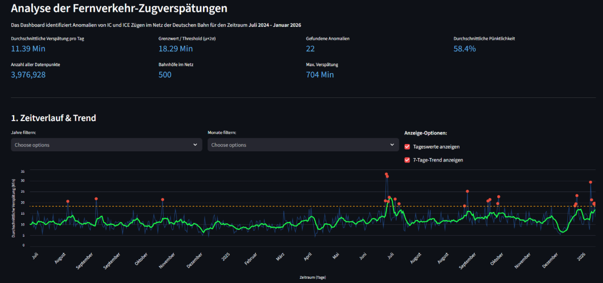
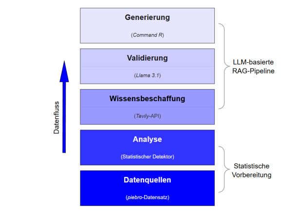
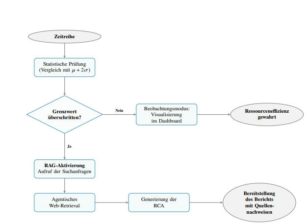
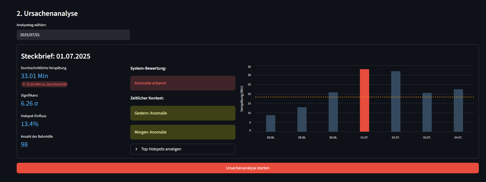
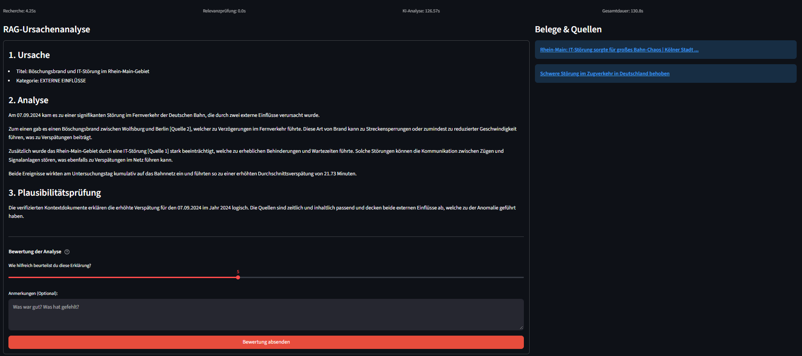
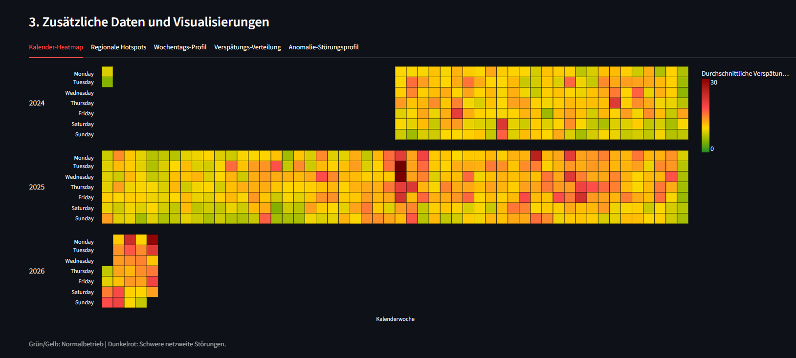
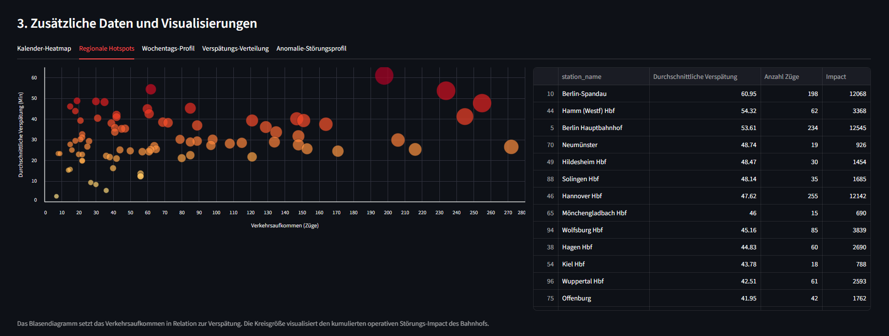
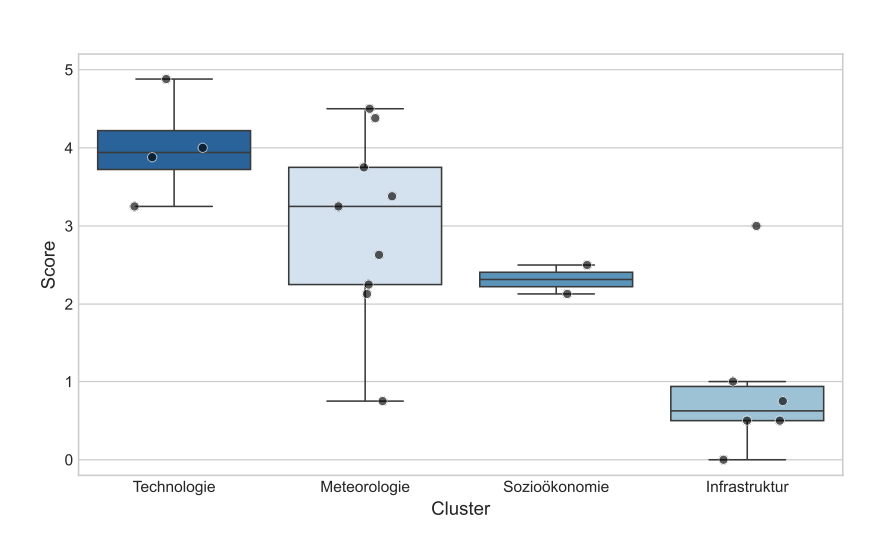

# KI-gestützte Anomalie- und Ursachenanalyse im Schienenfernverkehr

Eine Python- und Streamlit-Anwendung zur statistischen Erkennung von Verspätungsanomalien im deutschen Schienenfernverkehr (**ICE / IC / EC**) und anschließenden KI-gestützten Ursachenanalyse (**Root Cause Analysis**) mittels lokaler Sprachmodelle (**Ollama**) und dynamischer Webrecherche (**Tavily API**).



## Systemarchitektur & Methodik

Das System kombiniert eine statistische Anomalieerkennung auf historischen Fahrplandaten mit einer zweistufigen Retrieval-Augmented-Generation-Pipeline (RAG):



Nur an Tagen, an denen die durchschnittliche Verspätung den globalen Schwellenwert ($\mu + 2\sigma$) überschreitet, wird die kosten- und rechenintensive Webrecherche samt LLM-Auswertung ausgelöst:



## Kernfunktionen

* **Datenaufbereitung (`src/preprocessed.py`):** Bereinigung der monatlichen Rohdaten und Filterung auf den Fernverkehr (ICE, IC, EC).
* **Statistische Anomalieerkennung (`src/anomaly_detection.py`):** Berechnung des Schwellenwerts ($\mu + 2\sigma$), Identifikation kritischer Tage (`detected_anomalies.csv`) und Aufbereitung der Kontextdaten (`anomaly_context.json`).
* **Zweistufige RAG-Pipeline (`src/reasoning_engine.py`):** Gezielte Ereignisrecherche über die Tavily API, Relevanzfilterung durch `llama3.1` und strukturierte Ursachenrekonstruktion mit Quellenangaben durch `command-r`.
* **Interaktives Streamlit-Dashboard (`src/app.py`, `src/ui_components.py`):** Explorative Zeitreihen- und Kalendervisualisierungen, On-Demand-Ursachenanalyse und integriertes Qualitäts-Feedback (`evaluation/feedback_data.csv`).
* **Automatisierte Batch-Evaluation (`src/run_batch_evaluation.py`):** Reproduzierbare Testreihe über 21 historische Kern-Anomalietage mit Zeit- und Quellenmetriken (`evaluation/evaluation_log.csv`) sowie generiertem Gesamtbericht (`evaluation/report.md`).

## Dashboard & Evaluationsergebnisse

### Anomalie-Steckbrief & KI-Ursachenanalyse (RAG-Output)




### Kalender-Heatmap & Regionale Hotspots




### Evaluationsgüte nach Störungsursache


## Technologie-Stack

* **Sprache & Datenverarbeitung:** Python 3.10+, pandas, NumPy, PyArrow / Parquet
* **Visualisierung & UI:** Streamlit, Matplotlib, Seaborn
* **Lokale LLMs & Web-Retrieval:** Ollama (`command-r`, `llama3.1`), Tavily Search API

## Projektstruktur

```text
├── assets/                          # Architektur-, Dashboard- und Auswertungsgrafiken
├── data/
│   ├── raw/                         # Monatliche Rohdaten (nicht im Repository enthalten)
│   └── processed/                   # Generierte Parquet-, CSV- und JSON-Arbeitsdateien
├── evaluation/
│   ├── evaluation_log.csv           # Quantitative Laufzeit- und Quellenmetriken
│   ├── feedback_data.csv            # Gesammeltes Nutzer-Feedback aus dem Dashboard
│   └── report.md                    # Qualitative Ergebnisse der Batch-Evaluation
├── src/
│   ├── app.py                       # Streamlit-Dashboard (Einstiegspunkt)
│   ├── anomaly_detection.py         # Schwellenwertberechnung & Anomalieerkennung
│   ├── config.py                    # Modell- und Systemkonfiguration
│   ├── data_manager.py              # Daten-I/O und Feedback-Speicherung
│   ├── preprocessed.py              # Rohdatenbereinigung und Fernverkehrs-Filter
│   ├── reasoning_engine.py          # RAG-Engine (Tavily-Retrieval, Filterung, Generierung)
│   ├── run_batch_evaluation.py      # Automatisierte Evaluation über 21 Testtage
│   ├── style.css                    # Custom Styling für Streamlit
│   └── ui_components.py             # Diagramme und UI-Komponenten
├── tests/
│   ├── print_tree.py                # Hilfsskript zur Verzeichnisstruktur
│   ├── test_num_of_days.py          # Tests zur Tages- und Datumsabdeckung
│   ├── test_ollama_setup.py         # Verbindungstest für Ollama
│   ├── test_one_month_data.py       # Testlauf auf Monatsbasis
│   └── test_tavily_api_search.py    # Verbindungstest für die Tavily API
├── .env.example                     # Vorlage für Umgebungsvariablen
├── .gitignore
├── README.md
└── requirements.txt
```

## Installation & Setup

1. **Virtuelle Umgebung erstellen und Abhängigkeiten installieren:**
   ```bash
   python -m venv .venv
   source .venv/bin/activate  # Linux/macOS
   # .venv\Scripts\activate   # Windows
   pip install --upgrade pip
   pip install -r requirements.txt
   ```

2. **Umgebungsvariablen konfigurieren:**
   Kopiere `.env.example` nach `.env` und hinterlege deinen [Tavily API-Key](https://tavily.com):
   ```bash
   cp .env.example .env        # Linux/macOS/PowerShell
   # copy .env.example .env    # Windows (CMD)
   ```

3. **Lokale Sprachmodelle mit Ollama herunterladen:**
   Stelle sicher, dass [Ollama](https://ollama.com) installiert ist und läuft, und lade beide verwendeten Modelle herunter:
   ```bash
   ollama pull command-r   # Primäres Analyse- und Generierungsmodell
   ollama pull llama3.1    # Filter- und Validierungsmodell
   ```

## Datenbasis & Pipeline-Initialisierung

Da die historischen Fahrplandaten mehrere Gigabyte umfassen, sind sie nicht Teil dieses Repositories.

1. **Rohdaten herunterladen:**
   Lade die monatlichen `.parquet`-Dateien (`data-2024-07.parquet` bis `data-2026-01.parquet`) aus dem öffentlichen [piebro/deutsche-bahn-data Dataset auf Hugging Face](https://huggingface.co/datasets/piebro/deutsche-bahn-data/tree/main/monthly_processed_data) herunter und lege sie unter `data/raw/` ab.

2. **Vorverarbeitung und Filterung (ICE / IC / EC):**
   ```bash
   python src/preprocessed.py
   ```

3. **Profiling & Anomalieerkennung ($\mu + 2\sigma$):**
   ```bash
   python src/anomaly_detection.py
   ```
   Erzeugt `detected_anomalies.csv` und `anomaly_context.json` im Verzeichnis `data/processed/`.

## Nutzung

### Interaktives Streamlit-Dashboard starten
```bash
streamlit run src/app.py
```
*(Empfehlung in den Streamlit-Einstellungen: **Dark Theme** und **Wide Mode** aktivieren.)*

1. In der linken Seitenleiste das gewünschte Modell wählen (Standard: `command-r`).
2. Unter **„2. Ursachenanalyse“** ein Datum auswählen (statistische Anomalietage werden rot markiert).
3. Über **„Ursachenanalyse starten“** Web-Retrieval, Relevanzprüfung und Berichterstellung auslösen (Dauer ca. 2–4 Minuten).

### Automatisierte Batch-Evaluation ausführen
```bash
python src/run_batch_evaluation.py
```
Führt die Pipeline seriell für alle 21 vordefinierten Anomalietage aus und schreibt die Ergebnisse nach `evaluation/report.md` sowie `evaluation/evaluation_log.csv`.